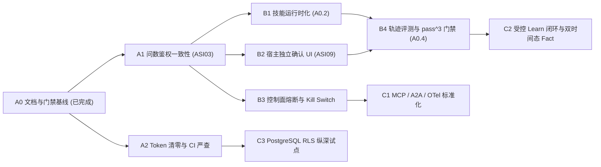

# 9+1 系统元语融合三阶段吸收计划（Phase A / B / C）

- 日期：2026-11-19
- 状态：**Phase A / Phase B / Phase C 全部 10 项 Change 已实现并通过全量构建与自动化测试验证**
- 关联元语文档：`CONSTITUTION.md`、`AGENTS.md`、`AGENT-PRIMITIVES.md`、`SPACE-MODEL.md`、`GOVERNANCE-MODEL.md`、`frontend/DESIGN.md`
- 关联既有计划：`docs/plans/2026-10-31-insight-pi-agent.md`、`docs/plans/2026-10-28-supersonic-50-eval.md`、`docs/plans/2026-10-26-analysis-report.md`

---

## 1. 目标与边界

本计划将“9+1”系统元语架构中经验证的高杠杆能力（P1 宪法与导航、A0.1–A0.4 智能体共性基座、OWASP ASI01–10 纵深安全、T2–T5 防漂移工具链与控制面）分三个阶段渐进吸收到本平台，**不破坏既有 8 Space 边界与 7 治理原语**，并确保每个阶段都产出可证伪、可机械验收的工程增量。

### Constitution Check（C1–C10）
- **C1 / C2**：不新增第 9 个业务 Space；所有新表与新接口继续严格遵循 `dg-app` 唯一装配与 Maven 依赖禁令；
- **C4 / C5**：消除所有合成/共享 Agent 身份路径，检索与数据访问坚持检索前鉴权与多租户纵深隔离；
- **C6 / C7**：坚持医疗私有化克制写回，不放开外部 HIS/业务库写回；平台内已有 Agent 写工具全部收口至宿主独立确认 UI 与后端二次校验；
- **C9 / C10**：知识沉淀仅经 `Staging → Diff 审校 → 可回滚晋升` 闭环，Agent 变更以独立裁判 + `pass^3` 回归为上线门槛。

---

## 2. 三阶段全景与 Changes 清单

| 阶段 | 周期参考 | Change ID | 核心能力 | 涉及模块 | 当前状态 |
|---|---|---|---|---|---|
| **Phase A** | 第 1–2 周 | `a0-primitives-foundation` | `CONSTITUTION.md`、`AGENTS.md`、`AGENT-PRIMITIVES.md`、首个 `SKILL.md`、`verify-primitives.py`、`openspec/config.yaml` | 文档 / `skills/` / `scripts/` / `openspec/` | ✅ 已完成 |
| **Phase A** | 第 1–2 周 | `a1-agent-read-auth-parity` | 补齐 `AgentToolController` `/datasets` 与 `/ask` 的 `userId` 实时鉴权与成员资格校验（消除 ASI03） | `backend/dg-app`、`agent-service` | ✅ 已完成 |
| **Phase A** | 第 1–2 周 | `a2-frontend-token-cleanup-ci` | 清零前端 4 处硬编码色值，将 `verify-primitives.py --strict` 接入 CI 门禁 | `frontend/`、`.github/workflows/` | ✅ 已完成 |
| **Phase B** | 第 3–6 周 | `b1-agent-skill-runtime` | `agent-service` 动态加载 `skills/*/SKILL.md`（Level 1/2 渐进披露 + `allowed-tools` 运行时裁剪），移除 `agent.ts` 硬编码流程提示词 | `agent-service/`、`skills/` | ✅ 已完成 |
| **Phase B** | 第 3–6 周 | `b2-agent-host-consent-ui` | 全部 Agent 写工具改为“先出结构化提案 → 前端宿主独立确认视图（Host Consent UI）→ 后端带签名令牌二次核验执行”（闭合 ASI09） | `agent-service/`、`backend/dg-app`、`frontend/` | ✅ 已完成 |
| **Phase B** | 第 3–6 周 | `b3-agent-control-plane-guard` | `AgentProxyController` 与 `agent-service` 增配单轮工具调用深度上限、循环检测、租户预算熔断与 Agent Kill Switch（闭合 ASI08 / ASI10） | `backend/dg-app`、`backend/dg-platform`、`agent-service/` | ✅ 已完成 |
| **Phase B** | 第 3–6 周 | `b4-trajectory-eval-passk` | 将 `evaluate-supersonic-50.py` 与引导式 Parquet 接入用例升级为 `/evals/regression/` 轨迹评测套件，引入终态 Outcome 校验、独立裁判与 `pass^3` 门禁 | `evals/`、`scripts/` | ✅ 已完成 |
| **Phase C** | 第 2–3 个月 | `c1-mcp-a2a-otel-alignment` | 内部工具适配标准 MCP Server 契约；跨系统 Agent（`dataQA` / `DeepAnalyze`）对齐 A2A 任务卡片；接入版本锁定的 OTel `gen_ai.*` 遥测 | `backend/dg-app`、`agent-service/`、`contracts/` | ✅ 已完成 |
| **Phase C** | 第 2–3 个月 | `c2-governed-learn-bitemporal-fact` | 激活 `GOVERNANCE-MODEL` 的 `Learn` 闭环：`knowledge/raw → research → articles` 编译管线 + `Fact` 双时间态演进 + 人工 Diff 审校与回滚 | `backend/dg-governance`、`backend/dg-metadata`、`knowledge/` | ✅ 已完成 |
| **Phase C** | 第 2–3 个月 | `c3-pg-rls-defense-in-depth` | 在 PostgreSQL 8 张核心治理/元数据/智能体表试点行级安全（RLS）纵深兜底 + `app.workspace_id` 会话注入 + 自动化跨租户隔离证明测试 | `backend/dg-app`、`backend/dg-common`、`scripts/` | ✅ 已完成 |

---

## 3. Phase A 详细实施计划（第 1–2 周：宪法、导航与机械门禁闭环）

### A.0 已完成基线（✅）
- 已落地根级宪法 [CONSTITUTION.md](../../CONSTITUTION.md)、导航地图 [AGENTS.md](../../AGENTS.md)（61/100 行）与智能体基座规约 [AGENT-PRIMITIVES.md](../../AGENT-PRIMITIVES.md)；
- 已抽离首个规范化技能包 [skills/parquet-local-onboarding/SKILL.md](../../skills/parquet-local-onboarding/SKILL.md)；
- 已上线机械门禁 [scripts/verify-primitives.py](../../scripts/verify-primitives.py) 并同步更新 [ARCHITECTURE.md](../../ARCHITECTURE.md) 与 [openspec/config.yaml](../../openspec/config.yaml)。

### A.1 `a1-agent-read-auth-parity`（消除 ASI03 鉴权缺口）
- **问题定位**：`backend/dg-app/src/main/java/com/datagov/app/controller/AgentToolController.java` 中 `/datasets` 与 `/ask` 当前调用 3 参 `withCaller(workspaceId, username, ...)`，直接伪造 `Caller("agent:" + username, ..., Set.of("insight:ask", "insight:read"))`，绕过了 `workspaceService.requireAccess` 与 `permissionService.resolvePermissions` 实时复核。
- **具体任务**：
  1. 修改 `AgentToolController.datasets` 与 `AgentToolController.ask` 接收 `X-Agent-User-Id`、`X-Agent-Username`、`X-Agent-Workspace-Id`、`X-Agent-Admin` 头，统一走 6 参 `withCaller(..., "insight:ask", ...)`（`/datasets` 校验 `insight:ask` 或 `insight:read`）；
  2. 移除不安全的 3 参合成 `withCaller(workspaceId, username, action)` 重载，从编译期杜绝回退；
  3. 确认 `agent-service/src/tools.ts` 的 `callBackend()` 已对全部请求透传 `X-Agent-User-Id` 等头（已有），补充缺少 `userId` 时显式拒绝的保护；
  4. 为 `AgentToolController` 补齐单元测试：合法成员通过、非空间成员被拒（403）、无 `insight:ask` 权限成员被拒（403）、缺失 `userId` 返回 400。
- **验证命令**：`mvn -pl backend/dg-app -am test`、`cd agent-service && npx tsc --noEmit`。

### A.2 `a2-frontend-token-cleanup-ci`（清零 Token 漂移 + CI 接入）
- **具体任务**：
  1. 替换 `verify-primitives.py` 检出的 4 处硬编码色值：
     - `frontend/src/views/error/ForbiddenView.vue:20`：`#909399` → `var(--dg-text-muted)`；
     - `frontend/src/views/login/LoginView.vue:118` / `127`：`#909399` → `var(--dg-text-muted)`；
     - `frontend/src/views/metadata/CatalogBrowserDrawer.vue:247`：`color="#e6a23c"` → `color="var(--dg-warning)"`（或绑定样式类）；
  2. 新增 `.github/workflows/primitives-guard.yml`，在 PR 与主干推送时自动执行 `python3 scripts/verify-primitives.py --strict`；
  3. 同步验证前端类型检查与构建无回归。
- **验证命令**：`python3 scripts/verify-primitives.py --strict`、`cd frontend && pnpm type-check && pnpm build`。

---

## 4. Phase B 详细实施计划（第 3–6 周：Agent 安全与技能运行时化）

### B.1 `b1-agent-skill-runtime`（A0.2 渐进式技能运行时加载）
- **目标**：消除 `agent-service/src/agent.ts` 中硬编码的 9 步 Parquet 流程提示词，实现标准的 Level 1 / Level 2 渐进披露与最小工具作用域裁剪。
- **具体任务**：
  1. 在 `agent-service/src/` 新增 `skills.ts` 加载器：启动时扫描 `../skills/*/SKILL.md`（路径支持 `SKILL_DIR` 环境变量配置），解析 YAML Frontmatter（`name`、`description`、`allowed-tools`）与正文；
  2. **Level 1 注入**：`systemPrompt()` 仅注入精炼静态基础指令 + 可用技能的 `name + description` 索引表（保持前缀稳定以命中提示词缓存）；
  3. **Level 2 激活**：新增只读元工具 `activate_skill(name)`（或服务端意图路由预激活），激活后加载对应 `SKILL.md` 正文并**按该技能的 `allowed-tools` 交集收窄当前轮次允许调用的写工具集合**；
  4. 将 `agent-service/src/agent.ts` 第 215–224 行的硬编码 Parquet 规则完全移除，改由 `skills/parquet-local-onboarding/SKILL.md` 驱动；
  5. 新增第二批核心技能：`skills/insight-data-ask/SKILL.md`（规范问数与脱敏说明），并跑通 `verify-primitives.py`。
- **验证**：未激活 `parquet-local-onboarding` 技能时，普通问数轮次不会注入其正文且无法调用写工具；提出“帮我接入本地 Parquet”时准确触发并完成全流程。

### B.2 `b2-agent-host-consent-ui`（Host Consent UI，闭合 ASI09）
- **目标**：杜绝 Agent 在自然语言聊天流内直接完成高危/写操作；所有写工具统一改为**“提案 → 宿主独立确认 → 后端二次校验执行”**两阶段协议。
- **涉及写工具**：`create_local_datasource`、`update_local_datasource`、`create_parquet_catalog_source`、`refresh_catalog_source`（以及未来所有新增写工具）。
- **具体任务**：
  1. **后端提案票据（Java）**：在 `dg-app` 引入 `AgentActionProposalService`（Flyway `V32__agent_action_proposal.sql` 或短生命周期表 `ig_agent_action_proposal`），存储 `{ proposalId, workspaceId, userId, actionType, payloadJson, payloadDigest, status(PENDING/APPROVED/REJECTED/EXECUTED/EXPIRED), expiresAt }`；
  2. **工具改造（Node）**：`agent-service/src/tools.ts` 中所有写工具改为先向 Java 申请生成 `PENDING` 提案并推送 SSE `consent_required` 事件（附客观结构化参数、目标资源、副作用说明），挂起等待或返回“待用户在宿主界面确认”；
  3. **宿主独立确认 UI（Vue 3）**：在 `frontend/src/components/agent/` 新增 `AgentConsentDialog.vue`（挂在 `AgentDock.vue` 与 `AskView.vue`），以不可被 Agent 文案篡改的表单字段展示操作类型、路径、目标空间与风险提示，提供“确认执行 / 拒绝”；
  4. **执行瞬间二次核验（Recheck at Execution）**：用户点击确认后，前端直接调用 Java `POST /api/v1/insight/agent/proposals/{id}/confirm`（带用户真实 JWT），Java 校验操作者 == 提案人、未过期、实时权限有效、参数摘要未篡改后再执行真实动作并写 `AuditRecord`，并将结果回推会话。
- **验证**：模型在聊天流内自称“已获得用户口头同意”无法绕过执行；非提案发起人调用 `/confirm` 返回 403；修改参数摘要或重放已执行提案被拒绝。

### B.3 `b3-agent-control-plane-guard`（控制面熔断与 Kill Switch，闭合 ASI08 / ASI10）
- **目标**：补齐“观测看得见、控制面拦得住”的运行时护栏。
- **具体任务**：
  1. **单轮工具深度与循环检测**：在 `agent-service/src/agent.ts` 配置硬上限（默认 `MAX_TOOL_CALLS_PER_TURN = 12`、`MAX_CONSECUTIVE_SAME_ERROR = 2`），命中连续相同语义错误时停止盲目重试，强制转入“解释原因并请人工决策”（Raise-and-Replan）；
  2. **路径白名单加固**：将 `AgentToolController.requireSafeRootPath` 从仅禁止 `/` 升级为可配置的允许前缀列表 `dg.insight.local-root-allowlist`（生产环境强制非空配置，开发环境可显式放开）；
  3. **租户预算熔断与 Kill Switch**：
     - 在 `AgentProxyController` 落地每租户/每用户速率与每日 Token/轮次配额检查（超限返回 429 并记审计）；
     - 新增平台管理员可一键切换的 `Agent Kill Switch`（全局开关 + 按 Workspace 开关，配置表 `ig_agent_control_policy` 或 `pf_workspace` 扩展列，Flyway `V33__agent_control_plane.sql`），开启后立即拒绝新消息并调用 `/abort` 中止运行中会话。
- **验证**：开启 Kill Switch 后 1 秒内阻断新对话并中止在途轮次；构造工具死循环在达到深度上限时自动熔断并落审计记录。

### B.4 `b4-trajectory-eval-passk`（A0.4 轨迹评测与 `pass^3` 回归门禁）
- **目标**：把一次性脚本 `scripts/evaluate-supersonic-50.py` 演进为平台长期维护的 `/evals/` 回归体系。
- **具体任务**：
  1. 建立标准目录：
     - `evals/capability/`（探索性能力集）
     - `evals/regression/`（CI 回归门禁集：精选 20–30 个高风险问数 + 脱敏校验 + 越权拒绝 + Parquet 接入提案轨迹用例）
     - `evals/graders/`（代码确定性裁判脚本 + 独立上下文 LLM Rubric 裁判）
  2. 实现统一运行器 `scripts/run-agent-evals.py`：
     - 支持 `--trials 3` 自动计算单题与套件级 `pass@k`、`pass^k`（重点门禁 `pass^3`）、平均耗时与 Token 消耗；
     - 强制校验**真实终态 Outcome**（数据库记录、脱敏列掩码、403/404 越权拦截、提案状态），不采信模型口头声称；
     - 产出 JSON + Markdown 评测报告（可存入 `tmp/` 或 CI artifact），与基线对比退化超过阈值时返回非零退出码。
- **验证**：离线 Mock/本地环境下 `python3 scripts/run-agent-evals.py --suite regression --trials 3` 可重复执行，准确输出 `pass^3` 指标并在人为注入权限漏洞或脱敏回归时准确报红。

---

## 5. Phase C 详细实施计划（第 2–3 个月：协议标准化与受控自演进）

### C.1 `c1-mcp-a2a-otel-alignment`（MCP / A2A / OTel `gen_ai.*` 对齐）
- **具体任务**：
  1. **纵向工具 MCP 化**：在 `backend/dg-app`（或独立轻量 MCP Adapter）按 MCP 无状态规约暴露已治理的只读资源与受控动作清单（`list_datasets`、`ask_data`、`get_catalog_asset`、`propose_local_onboarding`），保持现有 `/api/v1/internal/agent/*` 平滑过渡直至 `agent-service` 完成切换；
  2. **横向协作 A2A 契约化**：在 `contracts/a2a/` 为本平台、`dataQA`、`DeepAnalyze` 补充签名 `agent-card.json` 契约与不透明 Task/Artifact 映射（与 `INTEGRATION-ROADMAP.md` 及 `docs/analysis-report.md` 无缝对齐）；
  3. **统一遥测 OTel `gen_ai.*`**：
     - 在 `agent-service` 与 `AgentProxyController` 集中维护单一模块常量，锁定 OTel GenAI 语义规约版本，采集 `invoke_agent` / `chat` / `execute_tool` Span 及 `gen_ai.client.operation.duration`、`gen_ai.client.token.usage`；
     - 生产配置默认关闭原始 Prompt / 回复内容采集（防止患者敏感信息进入追踪系统），所有 `traceId` 与 `gv_audit_record`、`ig_query_log` 贯通。

### C.2 `c2-governed-learn-bitemporal-fact`（A0.1 + A0.3 激活 `GOVERNANCE-MODEL` Learn 闭环）
- **具体任务**：
  1. **双时间态 `Fact` 模型升级**（Flyway `V34__bitemporal_fact_and_staging.sql`）：
     - 为治理 `Fact`（术语口径、质量约定、分级结论、失败案例 `case`）补齐 `valid_from`、`valid_to`、`supersedes_id`、`state(PROPOSED/APPROVED/SUPERSEDED/ROLLED_BACK)`、`evidence_ref`、`feedback_source`；
     - 查询默认按当前有效区间过滤，并支持时间旅行查询（`asOf`）以还原历史口径；
  2. **编译型知识库目录与管线**：建立 `knowledge/{raw,research,articles}` + `index.md` / `log.md` / `maintenance-log.md`，实现离线/定时 Reflector 任务：仅从具备外部验证反馈的 `AnalysisReport(CONFIRMED)`、`ig_query_log` 人工纠偏或失败归因中提取增量条目写入 `research/` 或 `Fact(PROPOSED)`；
  3. **人工 Diff 审校与回滚**：复用既有治理收件箱（`gv_inbox_state`）或 Git PR 流程作为人类审校入口，提供一键批准晋升与游标回滚（应对 ASI06 记忆投毒），并将 `knowledge/` 断链与敏感词扫描纳入 `verify-primitives.py`。

### C.3 `c3-pg-rls-defense-in-depth`（PostgreSQL RLS 纵深隔离试点）
- **目标**：在不破坏现有 MyBatis-Plus `workspace_id` 应用层隔离的前提下，为医疗多租户等保增加数据库内核级兜底防线。
- **具体任务**：
  1. **试点表清单**（首批核心敏感与治理表）：`md_datasource`、`md_catalog_asset`、`md_column_sensitivity`、`gv_audit_record`、`gv_analysis_report`、`ig_query_log`；
  2. **数据库连接上下文注入**：在 `dg-app` 事务拦截器/数据源拦截器中，每次连接借出/事务开始时执行 `SET LOCAL app.workspace_id = '<workspaceId>'`（平台级跨空间任务使用显式最小只读角色）；
  3. **RLS 迁移与自动化证明**（Flyway `V35__pg_rls_pilot.sql`）：对试点表启用 `ENABLE ROW LEVEL SECURITY` + `FORCE ROW LEVEL SECURITY` 策略，并新增自动化测试脚本/JUnit 集成测试（基于 `embedded-postgres`），逐表证明“即使绕过应用层 WHERE 条件，也绝无法跨 Workspace 读/写任何一行”。

---

## 6. 数据库迁移、权限与审计规划总览

| 阶段 | Flyway 迁移（预估） | 新增/变更对象 | 权限码 / 审计落点 |
|---|---|---|---|
| Phase A | 无 | — | 复用 `insight:ask` / `insight:read`；`AuditService` 补齐真实 `userId` |
| Phase B | `V32__agent_action_proposal.sql` | `ig_agent_action_proposal`（提案与确认票据） | 复用各目标写动作原权限（如 `metadata:datasource:create`）；确认与拒绝全量写 `gv_audit_record` |
| Phase B | `V33__agent_control_plane.sql` | `ig_agent_control_policy`（配额、调用深度、Kill Switch） | 新增 `governance:agent:manage`（仅 `ws_admin`/平台管理员）；开关变更强制审计 |
| Phase C | `V34__bitemporal_fact_and_staging.sql` | `gv_fact_proposal` / 双时间态字段扩展 | 新增 `governance:knowledge:review`；晋升/驳回/回滚全量写 `gv_audit_record` |
| Phase C | `V35__pg_rls_pilot.sql` | 6 张试点表 PostgreSQL RLS 策略 | 无新权限码；集成测试 100% 覆盖跨租户拒绝 |

---

## 7. 依赖关系与并行顺序

- **可并行项**：Phase A 中 `A1` 与 `A2` 完全独立可并行；Phase B 中 `B1`、`B2`、`B3` 在 `A1` 完成后可按前后端分工并行推进，`B4` 收口验证；Phase C 中 `C1`、`C2`、`C3` 彼此解耦，可按客户等保与集成排期灵活排序。

---

## 8. 阶段验收口径（可证伪判据）

1. **Phase A 关门判据**：
   - `python3 scripts/verify-primitives.py --strict` 返回 `PASSED`（0 errors, 0 warnings）；
   - `AgentToolController` 合成 `Caller` 代码已彻底删除，越权用户调 `/datasets` 与 `/ask` 100% 返回 403；
   - `mvn -pl backend/dg-app -am test`、`cd frontend && pnpm type-check && pnpm build`、`cd agent-service && npx tsc --noEmit` 全绿。
2. **Phase B 关门判据**：
   - `agent-service/src/agent.ts` 不再包含硬编码业务流程步骤，Parquet 接入 100% 由 `skills/parquet-local-onboarding/SKILL.md` 动态驱动；
   - 任何写工具在不经宿主确认 UI 与 `/proposals/{id}/confirm` 二次校验时，数据库无任何状态变更；
   - Kill Switch 开启后 1 秒内阻断新请求并中止在途轮次；
   - `python3 scripts/run-agent-evals.py --suite regression --trials 3` 跑通且 `pass^3` 达到设定基线。
3. **Phase C 关门判据**：
   - 至少 1 条跨系统调用（`dataQA` 或 `DeepAnalyze`）带 OTel `gen_ai.*` Span 贯通且生产配置下零原始 Prompt 落盘；
   - 1 条分析归因经 `research/ → 人工 Diff 审校 → articles/` 晋升后可被检索命中，且执行回滚后立即恢复晋升前状态；
   - 6 张试点表在原生 SQL 绕过应用层条件时仍被 PostgreSQL RLS 100% 拦截跨 Workspace 读取。

---

## 9. 明确不做（Non-goals）

1. **不开放 Palantir 式外部业务库写回**：严守 `CONSTITUTION.md` C6 与 `GOVERNANCE-MODEL.md §K`，绝不让 Agent 直接写回 HIS / EMR / 业务生产库；
2. **不引入 Temporal**：维持 `dg-control` + Flink + K8s 的医疗私有化低运维底座，仅吸收确定性与概率性解耦铁律；
3. **不更换前端技术栈**：坚持 Vue 3 + TypeScript + Element Plus + `var(--dg-*)`，不迁移 Tailwind/shadcn；
4. **不引入“全量 GraphRAG”**：在缺乏真实多跳医学/跨文档需求前，不为普通目录与问数引入高运维图谱索引，先做好结构化语义层 + 检索前鉴权混合检索；
5. **不推翻既有 `SPACE-MODEL.md` / `GOVERNANCE-MODEL.md`**：所有增强均以向后兼容、增量 OpenSpec Change 方式推进。

---

## 10. 风险与回退策略

| 风险 | 触发条件 | 缓解与回退 |
|---|---|---|
| `B2` 宿主确认 UI 影响现有引导式接入体验 | 多步写操作频繁弹窗导致用户厌烦 | 对同一引导流程支持**单次批量计划确认**（一次确认“建源+建目录+采集”完整清单），既防 ASI09 又保持流畅 |
| `C3` PG RLS 在信创数据库（DM8/openGauss）方言差异 | 客户侧非 PostgreSQL 部署 | RLS 迁移脚本按 Spring Profile / 数据库方言条件启用，应用层 `WorkspaceContext` + MyBatis-Plus 隔离保持主防线不降级 |
| `C1` OTel GenAI 规约上游变动 | OTel `gen_ai.*` 仍处 Development 阶段 | 锁定 SDK 版本，所有属性常量收口单一适配文件并在 Collector 层归一化 |
| `B4` 轨迹评测成本高、CI 变慢 | 每次 PR 跑全量 50 题 × 3 次 | PR 门禁仅跑确定性代码裁判 + 10 题核心安全/回归子集；全量 `pass^3` 放夜间定时任务 |
