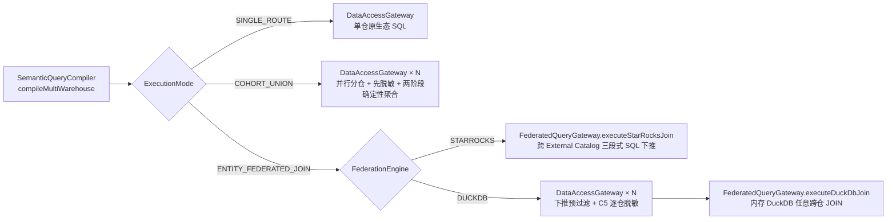

# Design: multisource-semantic-federation

## 1. 数据模型（Flyway V38）

### 1.1 `md_semantic_object` 共享作用域
- 新增列 `scope VARCHAR(16) NOT NULL DEFAULT 'WORKSPACE'`（可选值：`GLOBAL` | `WORKSPACE`）。
- PostgreSQL RLS 策略拆分为：
  - `SELECT` 策略：`app.rls_bypass = 'true' OR workspace_id = app.workspace_id OR (scope = 'GLOBAL' AND status = 'PUBLISHED')`
  - `INSERT / UPDATE / DELETE` 策略：`app.rls_bypass = 'true' OR workspace_id = app.workspace_id`（严格阻断任何租户篡改其他租户或全局模板行）。
- 同一 `code` 在当前 Workspace 内若同时存在 `WORKSPACE` 覆写与 `GLOBAL` 标准定义，编译器优先使用 `WORKSPACE` 定义，否则回落 `GLOBAL`。

### 1.2 `md_workspace_warehouse`（Workspace 多仓库挂载）
| 列名 | 类型 | 含义 |
|---|---|---|
| `id` | `VARCHAR(64)` PK | 仓库挂载 ID（`wh_...`） |
| `workspace_id` | `VARCHAR(64)` | 租户隔离键（PG RLS） |
| `datasource_id` | `VARCHAR(64)` | 关联 `md_datasource.id` |
| `code` | `VARCHAR(64)` | 空间内唯一标识（如 `mimic_iv`, `eicu_crd`, `his`） |
| `name` | `VARCHAR(160)` | 展示名 |
| `warehouse_role` | `VARCHAR(16)` | `PRIMARY` / `SECONDARY` |
| `cohort_code` | `VARCHAR(64)` | 队列/分区标识（如 `MIMIC_IV` / `EICU_CRD`） |
| `dialect` | `VARCHAR(32)` | `POSTGRESQL` / `STARROCKS` / `MYSQL` / `CLICKHOUSE` / `DUCKDB` |
| `id_namespace_prefix` | `VARCHAR(64)` | 主键命名空间前缀（如 `mimic:` / `eicu:`；互斥队列防碰撞） |
| `combine_mode` | `VARCHAR(32)` | `SINGLE_ROUTE` / `COHORT_UNION` / `ENTITY_FEDERATED_JOIN` |
| `federation_engine` | `VARCHAR(24)` | `AUTO` / `STARROCKS` / `DUCKDB` |
| `starrocks_catalog_name` | `VARCHAR(128)` | 若启用 StarRocks External Catalog，填写对应 catalog 名称 |
| `priority` | `INT` | 单仓路由或候选冲突时的排序优先级（越小越优先） |
| `status` | `VARCHAR(24)` | `ACTIVE` / `DISABLED` |

### 1.3 `md_logical_table`（MicroStrategy Warehouse Catalog 逻辑表）
- 字段：`id`, `workspace_id`, `warehouse_id`, `catalog_dataset_id`, `logical_name`, `table_role`（`LOOKUP`/`FACT`/`BRIDGE`/`VIEW_SQL`）, `alias_of_table_id`, `logical_size`（默认 1000，越小越优先）, `custom_view_sql`, `status`。
- 同一物理 `catalog_dataset_id` 可通过 `alias_of_table_id` 创建多个 Logical Table Alias，支持同一查询中的多角色自连接（Attribute Role）。

### 1.4 `md_semantic_mapping` 异构映射增强
- 新增列：`warehouse_id`, `logical_table_id`, `value_normalization_json`, `source_unit`, `target_unit`。
- `value_normalization_json` 示例：`{"Male":"M","Female":"F"}`，编译时确定性渲染为 `CASE <expr> WHEN 'Male' THEN 'M' WHEN 'Female' THEN 'F' ELSE <expr> END`。

## 2. 联邦查询执行架构

### 2.1 `COHORT_UNION` 两阶段确定性统计汇总（防辛普森悖论）
- `SUM(x)` → 分仓输出 `SUM(x)`，合并层求和；
- `COUNT(x)` → 分仓输出 `COUNT(x)`，合并层求和；
- `COUNT_DISTINCT(x)` → 若仓库配置了 `id_namespace_prefix`，在分仓内按命名空间隔离计数后在互斥队列下精确求和（因各仓命名空间严格不相交，`|A ∪ B| = |A| + |B|`）；
- `AVG(x)` → 分仓输出两个隐藏充分统计量列 `__sum_<alias>` 与 `__cnt_<alias>`，合并层精确计算 `SUM(__sum) / NULLIF(SUM(__cnt), 0)`；
- `MIN(x)` / `MAX(x)` → 合并层取最小/最大。

### 2.2 `ENTITY_FEDERATED_JOIN` 双引擎路由
- **StarRocks 模式**：当所有参与仓库都配置了 `starrocks_catalog_name` 且 Workspace 挂载了 `STARROCKS` 仓库（或策略指定 `STARROCKS`）时，直接生成跨 Catalog 三段式表名（`catalog.schema.table`）的统一 SQL，经 `FederatedQueryGateway.executeStarRocksJoin` 一次下推。
- **DuckDB 模式（默认兜底 & 零运维）**：对每个参与仓库生成精简列投影与谓词下推提取 SQL（`FederatedSourceExtract`），经 `DataAccessGateway` 逐仓执行并先做 C5 L3/L4 脱敏，再通过 `FederatedQueryGateway.executeDuckDbJoin` 装载至隔离的 `:memory:` DuckDB 临时表并执行跨仓 `JOIN / GROUP BY / ORDER BY`。

## 3. REST API 契约

- `GET /api/v1/metadata/semantic/warehouses`
- `POST /api/v1/metadata/semantic/warehouses`
- `DELETE /api/v1/metadata/semantic/warehouses/{id}`
- `GET /api/v1/metadata/semantic/logical-tables`
- `POST /api/v1/metadata/semantic/logical-tables`
- `POST /api/v1/metadata/semantic/logical-tables/{id}/alias`
- `DELETE /api/v1/metadata/semantic/logical-tables/{id}`
- `GET /api/v1/metadata/semantic/objects/{id}/mapping-matrix`
- `POST /api/v1/metadata/semantic/compile-plan`
